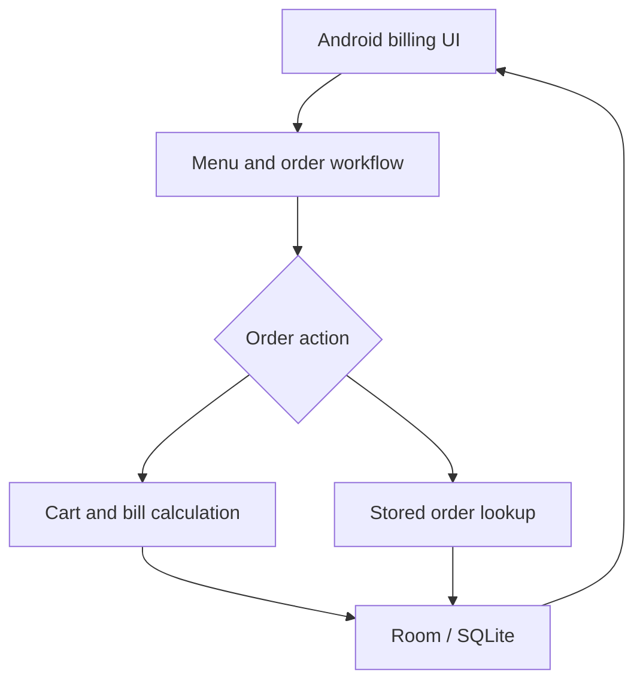

# Pizza Cafe Billing — Offline Android App

Offline Android restaurant-billing project with Kotlin application code, local storage, menu management, and order workflows.

## Project focus

Application / engineering project. The sections below separate the runnable entry point, source layout, prerequisites, and verification path.

## Architecture



## Repository structure

| Path | Purpose |
| --- | --- |
| [`.github/`](.github) | Repository automation and workflows. |
| [`LICENSE`](LICENSE) | Repository licensing terms. |
| [`app/`](app) | Application source; inspect this directory for the framework-specific implementation. |
| [`build.gradle`](build.gradle) | Project-specific source, resources, or learning material. |
| [`gradle.properties`](gradle.properties) | Project-specific source, resources, or learning material. |
| [`settings.gradle`](settings.gradle) | Project-specific source, resources, or learning material. |

## Getting started

```bash
git clone https://github.com/Raimal-Raja/pizza-cafe-billing.git
cd pizza-cafe-billing
```

Open this repository in Android Studio and let Gradle resolve the versions declared in the project. Select an Android emulator or connected device and build the app module.

The repository contains `build.gradle` and `settings.gradle`; use your configured Gradle installation or Android Studio when a Gradle wrapper is absent. See the retained project guide for app workflows and supported device requirements.

## Verification

Use the setup commands and inspect the selected interface, example, or notebook with known inputs. This documentation review checks repository paths and dependency declarations; it does not claim fresh end-to-end execution or model-quality measurements.

## Detailed project guide

A native Android app (Kotlin) for a single-till restaurant billing system,
pre-loaded with the Pizza Cafe (Badin) menu. Works fully offline — all data
is stored locally on the device using Room (SQLite), no internet needed.

## Features
- **New Order** screen for Dine-in / Delivery / Takeaway, with a live cart and total
- **Table tracking** for dine-in (type a table number/name per order)
- **Home delivery** with configurable delivery zones + charges, and a
  "free delivery above Rs. X" rule (edit the threshold in Settings)
- **Menu Manager** — add, edit, delete items and prices, mark pizza items as
  "flavor items" so staff pick a flavor (B.BQ Tikka, Fajita, Supreme, etc.)
  at order time without it affecting price
- **Orders** — see all open/billed/completed orders, tap to resume or view bill
- **Billing / receipt** — itemized bill screen with subtotal, delivery charge,
  and total; **Print** button sends the receipt to any printer registered on
  the Android device (via Android's built-in Print framework — works with
  "Save as PDF", most Wi-Fi/network printers, and printers that ship their
  own Android print-service app; see note below for thermal receipt printers)

## Project structure
- `data/` — Room entities (MenuItem, Order, OrderItem, DeliveryZone,
  FlavorOption), DAOs, `AppDatabase` (seeds the menu on first run from
  `SeedData.kt`)
- `ui/` — one Activity per screen, plus RecyclerView adapters in `ui/adapters/`
- `util/` — `Currency.kt` (Rs. formatting), `Prefs.kt` (restaurant info,
  table count, free-delivery threshold — stored in SharedPreferences)

## Opening the project
1. Install **Android Studio** (Koala/2024.x or newer).
2. `File → Open` and select the `PizzaCafeBilling` folder.
3. This project doesn't ship a Gradle wrapper jar — Android Studio will
   prompt to **create the Gradle wrapper** automatically on first open; accept
   it (or click "Sync Now" and let it generate). It will download Gradle 8.6+
   the first time, so do this once with an internet connection.
4. Let Gradle sync (it will pull Room, Material Components, etc. from Maven).
5. Run on an emulator or a plugged-in Android phone (minSdk 23, i.e. Android 6+).

## Menu data
All prices were transcribed from your printed menu photos into
`data/SeedData.kt`. Everything there is editable later from **Menu Manager**
in the app — `SeedData.kt` only seeds the database the very first time the
app launches (so editing it after that has no effect; edit in-app instead,
or delete the app's data to reseed).

One item's price was partly hidden in the photo:
- **Qtr Broast** was seeded at **Rs. 400** — please verify and correct this
  in Menu Manager.

## Delivery charges
Settings → Delivery Zones lets you add/remove zones with their own charge
(e.g. "Standard — Rs. 100"). Settings also has a **free delivery threshold**
(defaults to Rs. 500, matching "Delivery Charges Apply on Under Rs.500 Order"
from your menu) — orders at or above that subtotal get free delivery
automatically regardless of zone.

## About receipt printing
Android's Print framework (used here) works well with:
- "Save as PDF" (built into every Android device) — good enough to review/
  email a bill even with no printer attached
- Wi-Fi/network printers and most printers with an official Android print
  service app installed

**Small Bluetooth thermal (ESC/POS) receipt printers** — the kind many
takeaway counters use — usually need the printer manufacturer's own SDK/print
service rather than the generic Android Print framework. If you have a
specific thermal printer model, that integration can be added on top of this
project; the bill data and itemized layout are already separated out in
`BillActivity.kt` (`buildReceiptHtml`) so it's a contained addition.

## Notes / known simplifications (MVP)
- Single till / single device — no multi-device sync (you didn't need this yet)
- "Flavor" selection for pizzas is a free label attached to the order line,
  not a separate priced item — matches how the menu prices pizzas (by size,
  not by flavor)
- Table numbers are free-text, not a fixed floor plan — quick to use, no
  setup required

## Git / push note
If Git reports a README conflict or says the branch cannot be pushed, it is usually
because the remote branch has changed since your last pull, or because a merge
conflict is still open in `README.md`.

To fix it:
1. Pull the latest branch changes: `git pull --rebase origin <branch-name>`
2. Resolve any conflict markers in `README.md` and keep the correct final text
3. Stage the file: `git add README.md`
4. Commit and push again: `git commit -m "Resolve README conflict"` and
   `git push origin <branch-name>`

If the issue is only that the README shows as modified but not pushed, make sure
there are no unmerged conflict markers left and that you are pushing to the
correct branch.

---

## Contributing

Include reproduction steps, the affected path, expected behavior, and the checks you ran. Keep credentials, generated environments, and unnecessary build artifacts out of commits.

## License

See [LICENSE](LICENSE) for the repository's license.
